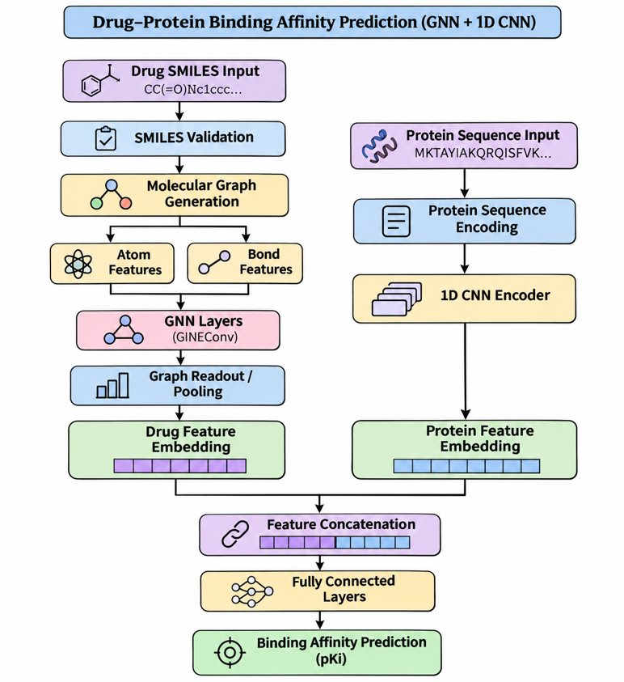
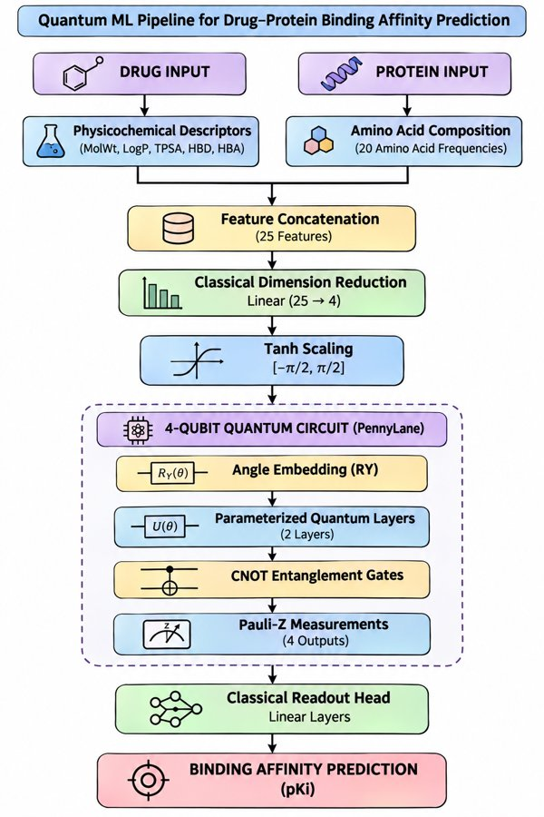
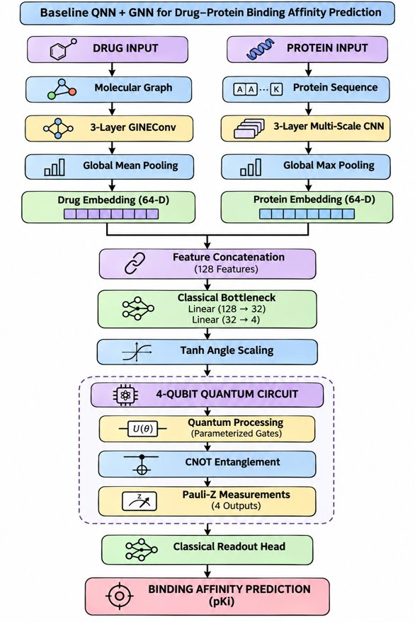
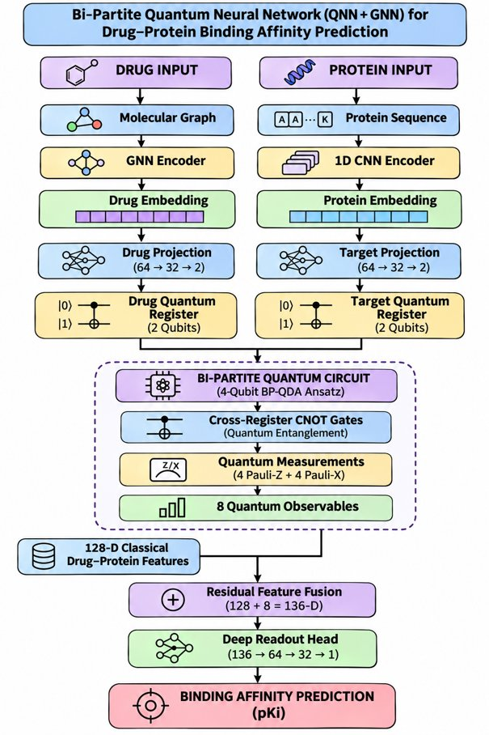
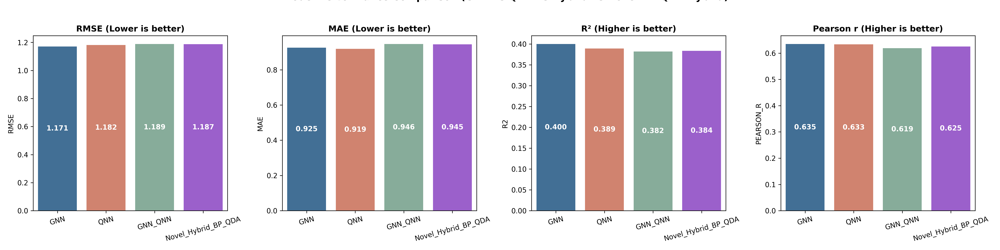
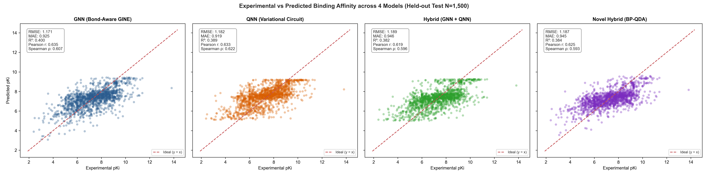
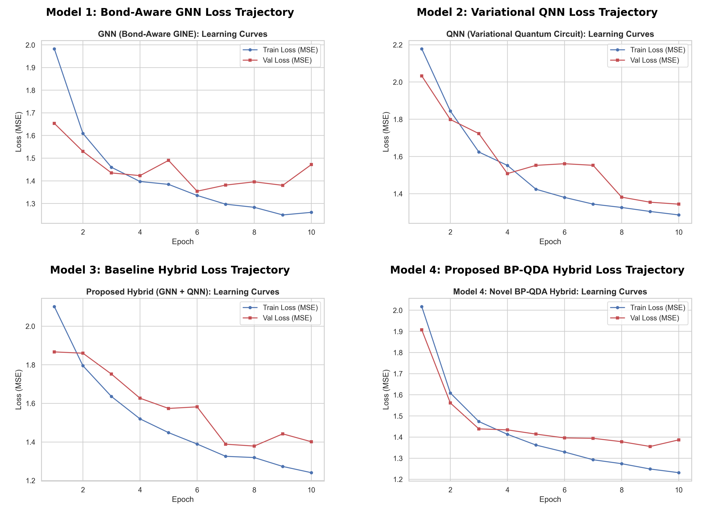
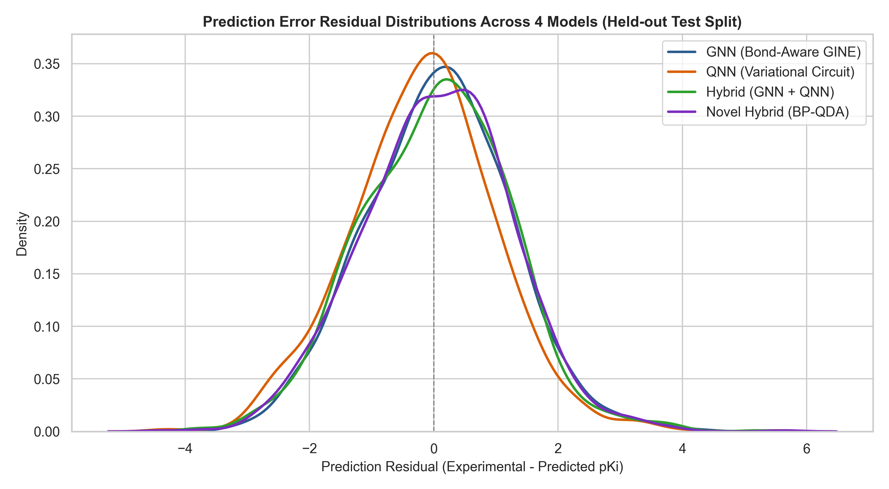

# Graph Neural Network-Based and Quantum Neural Network-Based Drug–Target Interaction Prediction

[](https://www.python.org/downloads/release/python-3100/)
[](https://pytorch.org/)
[](https://pyg.org/)
[](https://pennylane.ai/)
[](https://opensource.org/licenses/MIT)

> **Authors:** Shasank Vuppala<sup>1</sup>, Kalyan Ram Vattikonda<sup>1</sup>, Dr. Anu M<sup>2</sup>  
> <sup>1</sup>*Centre for Artificial Intelligence and Drug Discovery, Department of Computer Science and Engineering*  
> <sup>2</sup>*Faculty Project Advisor, Department of Computer Science and Engineering*

---

## 📌 Project Overview

Quantitative prediction of **Drug–Target Interaction (DTI)** binding affinity is a fundamental challenge in computational drug discovery, high-throughput virtual screening, and lead optimization. While many machine learning approaches simplify DTI into an active/inactive binary classification task, this dichotomization discards quantitative biophysical potency gradients spanning multiple orders of magnitude.

In this research, we formulate DTI strictly as a **continuous affinity regression** problem predicting the negative logarithmic equilibrium inhibition constant:
$$\text{pKi} = -\log_{10}(K_i\,[\text{M}]) = 9.0 - \log_{10}(K_i\,[\text{nM}])$$

Our models are trained and benchmarked on a curated, non-redundant dataset of **10,000 high-quality binding pairs** derived from the public **BindingDB** repository (covering **8,508 unique molecules** and **853 diverse protein targets**). We design, implement, and benchmark four distinct computational paradigms under an identical, leak-free experimental protocol:

1. **Model 1 — Classical Bond-Aware GNN:** A 3-layer Graph Isomorphism Network with Edge features (`GINEConv`) for small-molecule graph topology combined with a multi-scale 1D CNN for protein sequence motifs.
2. **Model 2 — Standalone Variational QNN:** A 4-qubit hardware-efficient Variational Quantum Circuit (VQC) executing Angle Embedding, circular CNOT entanglement, and Pauli-$Z$ observable measurements via PennyLane.
3. **Model 3 — Baseline Hybrid (GNN + QNN):** A multimodal model compressing 128-dimensional classical graph-sequence representations into 4 qubits via a 32-fold linear bottleneck.
4. **Model 4 — Proposed Novel BP-QDA Hybrid:** A **Bi-Partite Quantum Docking Ansatz** featuring register partitioning (2 qubits drug, 2 qubits target), cross-boundary docking CNOT operations, quantum data re-uploading, and a **136-dimensional classical residual skip highway**.

---

## 🏗️ System Architecture & Model Designs

### Model 1: Classical Bond-Aware Graph Neural Network (GNN + 1D CNN)
Combines atom attributes (41-d) and bond attributes (16-d) in small-molecule graphs with hierarchical 1D CNN protein sequence representations (kernels 4, 8, 12).


### Model 2: Standalone Variational Quantum Neural Network (QNN)
A compact 4-qubit parameter-efficient variational circuit mapping classical molecular descriptors and amino acid composition into a 16-dimensional Hilbert state space.


### Model 3: Baseline Hybrid Architecture (GNN + QNN)
A standard sequential hybrid design illustrating the **Dimensional Bottleneck Problem**: compressing a 128-d multimodal classical embedding down to 4 qubits via a 32-fold linear compression layer.


### Model 4: Proposed Novel Bi-Partite Quantum Docking Hybrid (BP-QDA)
Our novel architecture resolving the hybrid bottleneck: dedicated 2-qubit drug and target registers, inter-register docking CNOT entanglement, quantum data re-uploading, and a **136-d classical residual skip highway**.


---

## 📊 Experimental Results & Benchmarking

All four models were evaluated on the held-out test partition ($N = 1,500$ pairs) with zero pair leakage from training:

| Model Architecture | Test RMSE (↓) | Test MAE (↓) | $R^2$ Score (↑) | Pearson $r$ (↑) | Spearman $\rho$ (↑) | Best Epoch | Train Time |
| :--- | :---: | :---: | :---: | :---: | :---: | :---: | :---: |
| **Model 1: Classical GNN** (`GINEConv` + 1D CNN) | **1.1711** | 0.9252 | **0.4000** | **0.6346** | 0.6069 | Epoch 6 | 193.12 s |
| **Model 2: Standalone QNN** (4-Qubit VQC via PennyLane) | 1.1818 | **0.9191** | 0.3891 | 0.6333 | **0.6223** | Epoch 10 | **174.67 s** |
| **Model 3: Baseline Hybrid** (32x Linear Bottleneck) | 1.1886 | 0.9463 | 0.3820 | 0.6186 | 0.5962 | Epoch 8 | 266.68 s |
| **Model 4: Proposed BP-QDA Hybrid** (136-d Skip Highway) | 1.1869 | 0.9448 | 0.3838 | 0.6248 | 0.5931 | Epoch 9 | 238.57 s |

### 📈 Output Visualizations & Comparative Analyses

#### 1. 4-Model Comparative Benchmark Performance
Grouped comparison across all evaluation metrics demonstrating Model 1's lead in Euclidean variance (RMSE) and Model 2's lead in absolute error (MAE) and monotonic rank correlation (Spearman $\rho$).


#### 2. Actual vs. Predicted Affinity Scatter Plots
4-panel scatter plot matrix showing actual versus predicted $\text{pKi}$ on the held-out test set ($N = 1,500$) with density contours and identity diagonal ($y = x$).


#### 3. Training & Validation Loss Trajectories
Optimization curves across epochs showing rapid, stable convergence between Epochs 6 and 10 with zero gradient divergence or barren plateau stagnation.


#### 4. Prediction Error Residual Distributions
Residual histograms ($y_i - \hat{y}_i$) and Kernel Density Estimates confirming zero-centered Gaussian distributions ($\mu \approx 0.00 \pm 0.02$) with over 80% of predictions within $\pm 1.0$ log unit.


---

## 🔍 Key Scientific Insights

1. **GNN Dominance in Euclidean Variance:** Model 1 achieves the lowest RMSE ($1.1711$) and highest $R^2$ ($0.4000$) due to bond-aware message passing on full 64-dimensional atom-bond representations.
2. **QNN Ranking Fidelity & Inductive Bias:** Model 2 attains the lowest MAE ($0.9191$) and highest Spearman $\rho$ ($0.6223$) with only 1,225 parameters. Pauli-$Z$ trigonometric expectation values act as an **intrinsic regularizer**, suppressing extreme outlier predictions.
3. **The Hybrid Bottleneck Identified:** Naive 32-fold linear compression in Model 3 ($128 \to 4$) discards $>90\%$ of topological variance, causing performance degradation below standalone baselines ($\text{RMSE} = 1.1886$).
4. **Restoring Expressivity via BP-QDA:** Model 4 overcomes this bottleneck via bi-partite register partitioning, cross-docking CNOT gates, and a 136-dimensional classical residual skip highway ($\text{RMSE} = 1.1869$, Pearson $r = 0.6248$).

---

## 📁 Repository Structure

```
├── assets/
│   ├── architectures/               # System design diagrams for Models 1–4
│   │   ├── model1_gnn_1dcnn_architecture.jpg
│   │   ├── model2_qnn_pipeline_architecture.jpg
│   │   ├── model3_baseline_hybrid_architecture.jpg
│   │   └── model4_bipartite_hybrid_architecture.jpg
│   └── results/                     # Experimental output plots
│       ├── model_comparison_4models.png
│       ├── prediction_comparison_4models.png
│       ├── residual_distribution_4models.png
│       └── training_curves_4models.png
├── checkpoints/                     # Trained PyTorch model weights (.pt)
│   ├── GNN/
│   ├── QNN/
│   ├── GNN_QNN/
│   └── Novel_Hybrid/
├── common/                          # Core data pipelines and shared utilities
│   ├── affinity_processing.py       # pKi transformation and censorship filtering
│   ├── compare_4models.py           # 4-model evaluation synthesis
│   ├── config.py                    # Global hyperparameters and directory paths
│   ├── data_splitting.py            # Leak-free 70/15/15 train/val/test splitting
│   ├── dataset_loader.py            # PyG DataLoader and mini-batch collation
│   ├── evaluation.py                # RMSE, MAE, R², Pearson, Spearman metrics
│   ├── molecular_graph.py           # RDKit graph featurization (41 atom, 16 bond feats)
│   ├── preprocess.py                # 6-stage BindingDB curation pipeline
│   ├── protein_encoder.py           # 20 AA embedding + multi-scale 1D CNN
│   └── reproducibility.py           # Seed 42 deterministic initialization
├── data/
│   ├── processed/                   # Curated 10,000-sample dataset (.csv & .parquet)
│   └── splits/                      # Train (7k), Val (1.5k), Test (1.5k) partitions
├── models/
│   ├── GNN/                         # Model 1: Bond-aware GINEConv architecture
│   ├── QNN/                         # Model 2: Standalone 4-qubit VQC
│   ├── GNN_QNN/                     # Model 3: Baseline hybrid with linear bottleneck
│   └── Novel_Hybrid/                # Model 4: Proposed BP-QDA hybrid architecture
├── results/                         # Evaluation metrics CSVs and per-model figures
├── tests/                           # Unit tests and smoke tests
├── evaluate_4models.py              # CLI script to evaluate all 4 models on test set
├── run_pipeline.py                  # CLI pipeline runner
├── run_all.py                       # Master end-to-end execution script
├── requirements.txt                 # Python dependencies
└── README.md
```

---

## 🚀 Quick Start & Installation

### 1. Environment Setup
```bash
# Clone the repository
git clone https://github.com/Shasank-Vuppala/Graph-Neural-Network-Based-and-Quantum-Neural-Network-Based-Drug-Target-Interaction-Prediction.git
cd Graph-Neural-Network-Based-and-Quantum-Neural-Network-Based-Drug-Target-Interaction-Prediction

# Create and activate virtual environment
python -m venv venv
# On Windows:
venv\Scripts\activate
# On Linux/macOS:
source venv/bin/activate

# Install dependencies
pip install -r requirements.txt
```

### 2. Evaluate Trained Models on Test Set (5-Second Evaluation)
All four pre-trained checkpoints are provided in `checkpoints/`. Run the unified evaluation script to reproduce test results and generate comparison tables:
```bash
python evaluate_4models.py
```

### 3. Run Pipeline Stages Individually
```bash
# Inspect dataset
python run_pipeline.py --stage inspect

# Preprocess BindingDB raw TSV into curated 10,000 dataset
python run_pipeline.py --stage preprocess

# Train individual models (e.g. Model 4: BP-QDA Hybrid)
python -m models.Novel_Hybrid.train --epochs 15 --batch-size 64

# Run test set evaluation for Model 4
python -m models.Novel_Hybrid.evaluate
```

---

## 📦 Dataset Details

* **Source:** BindingDB (September 2026 Release, 8.368 GB, 3,237,052 raw records).
* **Curated Subset:** Exactly 10,000 non-redundant pairs with positive, uncensored $K_i$ measurements.
* **Chemical Space:** 8,508 unique validated small molecules (RDKit sanitization).
* **Biological Space:** 853 unique single-chain protein targets (lengths 30–1,200 residues).
* **Target Representation Cap:** Maximum 150 compounds per target to ensure proteome-wide diversity.
* **Affinity Range:** $\text{pKi} \in [2.01, 13.82]$, mean $7.32 \pm 1.49$, median $7.31$.

---

## 📚 Key References

1. **DeepDTA:** Öztürk, H., Özgür, A., & Ozkirimli, E. (2018). DeepDTA: Deep drug–target binding affinity prediction. *Bioinformatics*, 34(17), i821–i829. [doi:10.1093/bioinformatics/bty593](https://doi.org/10.1093/bioinformatics/bty593)
2. **DeepAffinity:** Karimi, M., Wu, D., Wang, Z., & Shen, Y. (2019). DeepAffinity: Interpretable deep learning of compound–protein affinity through unified recurrent and convolutional neural networks. *Bioinformatics*, 35(18), 3329–3338. [doi:10.1093/bioinformatics/btz111](https://doi.org/10.1093/bioinformatics/btz111)
3. **GraphDTA:** Nguyen, T., Le, H., Quinn, T. P., Nguyen, T., Le, T. D., & Venkatesh, S. (2021). GraphDTA: Predicting drug–target binding affinity with graph neural networks. *Bioinformatics*, 37(8), 1140–1147. [doi:10.1093/bioinformatics/btaa921](https://doi.org/10.1093/bioinformatics/btaa921)
4. **MolTrans:** Huang, K., Xiao, C., Glass, L. M., & Sun, J. (2021). MolTrans: Molecular interaction transformer for drug–target interaction prediction. *Bioinformatics*, 37(6), 830–836. [doi:10.1093/bioinformatics/btaa880](https://doi.org/10.1093/bioinformatics/btaa880)
5. **PocketDTA:** Zhao, L., Wang, H., & Shi, S. (2024). PocketDTA: An advanced multimodal architecture for enhanced prediction of drug–target affinity from 3D structural data of target binding pockets. *Bioinformatics*, 40(10), btae594. [doi:10.1093/bioinformatics/btae594](https://doi.org/10.1093/bioinformatics/btae594)
6. **QKDTI:** Pallavi, G., Altalbe, A., & Kumar, R. P. (2025). QKDTI: A quantum kernel based machine learning model for drug target interaction prediction. *Scientific Reports*, 15, 27103. [doi:10.1038/s41598-025-07303-z](https://doi.org/10.1038/s41598-025-07303-z)

---

## 📖 Citation

If you find this work or codebase helpful in your research, please cite:
```bibtex
@inproceedings{vuppala2026gnn_qnn_dti,
  title     = {Graph Neural Network-Based and Quantum Neural Network-Based Drug--Target Interaction Prediction},
  author    = {Vuppala, Shasank and Vattikonda, Kalyan Ram and M, Anu},
  booktitle = {Proceedings of the IEEE Conference on Computational Biology, Bioinformatics and Quantum Machine Learning},
  year      = {2026}
}
```

---

## 📄 License
This project is licensed under the MIT License — see the [LICENSE](LICENSE) file for details.
