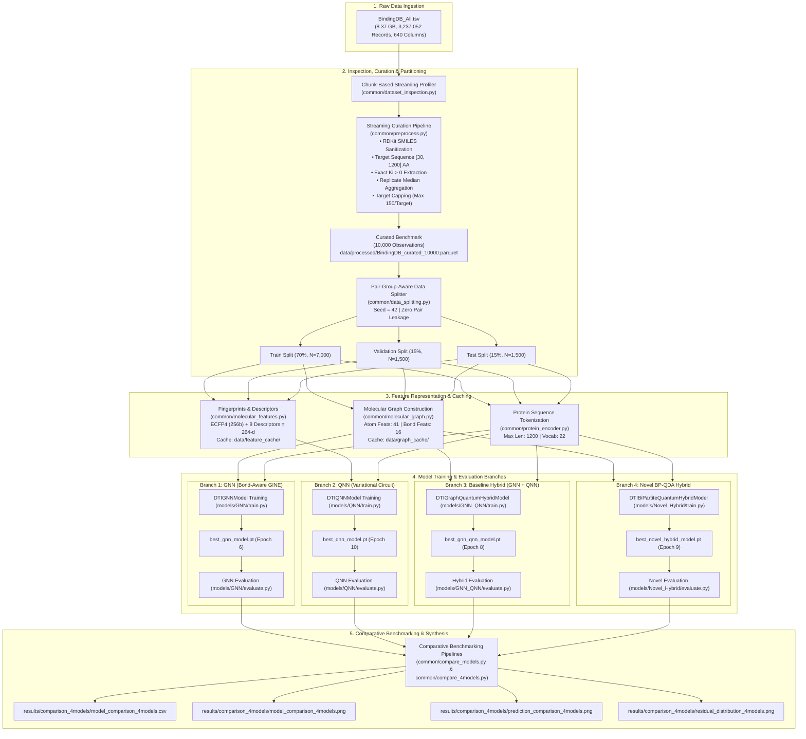
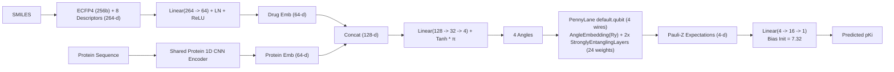
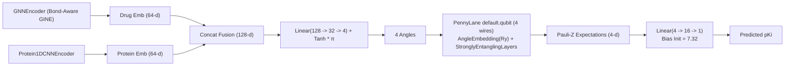

# System Architecture & Technical Specification
## Graph Neural Network-Based and Quantum Neural Network-Based Drug–Target Interaction Prediction

---

### Executive Architectural Summary
This document delineates the technical architecture, mathematical modeling, tensor flow pathways, and operational pipelines implemented in this investigation. The system predicts continuous drug–target binding affinity ($p\text{Ki}$) from 2D molecular structures and 1D protein amino acid sequences across **four comparative computational intelligence paradigms**:
1. **Model 1: Graph Neural Network (GNN)** — Edge-Attentive Graph Isomorphism Network (`GINEConv`) operating on 41 atom and 16 bond features paired with a 1D Convolutional Neural Network (CNN) target sequence encoder.
2. **Model 2: Quantum Neural Network (QNN)** — Extended connectivity circular fingerprints (`ECFP4`), 8 biophysical physicochemical descriptors, shared 1D CNN target sequence encoder, a 4-qubit Parameterized Quantum Circuit (PQC), and classical regression readout.
3. **Model 3: Baseline Hybrid (GNN + QNN)** — Couples the bond-aware GINE graph encoder with the 1D CNN protein encoder, compresses the joint 128-d manifold to 4 quantum rotation angles, executes a 4-qubit variational circuit with all-to-all strong entanglement, and projects Pauli-Z expectation values to binding affinity predictions via end-to-end backpropagation.
4. **Model 4: Novel Bi-Partite Quantum Docking Hybrid (BP-QDA)** — Novel physics-informed architecture featuring independent 2-qubit registers for Drug ($\mathcal{H}_{\text{drug}}$) and Protein Target ($\mathcal{H}_{\text{target}}$), parameterized inter-entity entangling unitaries across the contact interface boundary (Qubit 1 $\leftrightarrow$ Qubit 2), Quantum Data Re-Uploading ($R_x$), 8 multi-basis and cross-correlator observables ($\langle Z_1 \otimes Z_2 \rangle$, $\langle X_1 \otimes X_2 \rangle$), and a **Quantum Residual Skip Connection** preserving full 128-d classical latent capacity.

---

### 1. End-to-End System Workflow

---

### 2. Four Detailed Model Architectures

#### 2.1 Model 1: Bond-Aware Graph Neural Network (GNN)

```mermaid
flowchart LR
    SMILES["SMILES"] --> RDKit_G["PyG Graph Builder"]
    RDKit_G --> NodeX["Atom Features (41-d)"]
    RDKit_G --> EdgeAttr["Bond Features (16-d)"]
    NodeX --> ProjA["Linear(41 -> 64)"]
    ProjA --> GINE1["GINEConv 1 + BN + ReLU + Res"]
    GINE1 --> GINE2["GINEConv 2 + BN + ReLU + Res"]
    GINE2 --> GINE3["GINEConv 3 + BN + ReLU + Res"]
    EdgeAttr --> GINE1 & GINE2 & GINE3
    GINE3 --> MeanPool["Mean Pool (64)"]
    GINE3 --> MaxPool["Max Pool (64)"]
    MeanPool & MaxPool --> CatPool["Concat Pool (128)"]
    CatPool --> ReadoutG["Linear(128 -> 64) + LN + ReLU"] --> DrugEmb["Drug Embedding (64-d)"]

    FASTA["Protein Sequence"] --> Tok["Tokenize (1200)"] --> Emb["Embedding(22, 64)"]
    Emb --> Conv1["Conv1d(64, 64, k=7) + ReLU"] --> Conv2["Conv1d(64, 64, k=7) + ReLU"]
    Conv2 --> AdPool["AdaptiveMaxPool1d(1)"] --> ProtFC["Linear(64 -> 64) + LN"] --> ProtEmb["Protein Embedding (64-d)"]

    DrugEmb & ProtEmb --> Fused["Concat Fusion (128-d)"]
    Fused --> MLPHead["Linear(128 -> 64 -> 32 -> 1)<br/>Bias Init = 7.32"] --> Pred["Predicted pKi"]
```

#### 2.2 Model 2: Standalone Variational QNN

#### 2.3 Model 3: Baseline Hybrid (GNN + QNN)

#### 2.4 Model 4: Novel Bi-Partite Quantum Docking Hybrid (BP-QDA)

```mermaid
flowchart LR
    GNN4["GNNEncoder (GINE)"] --> D_Emb["Drug Embedding (64-d)"]
    CNN4["Protein1DCNNEncoder"] --> P_Emb["Protein Embedding (64-d)"]

    D_Emb --> ProjD["Linear(64 -> 32 -> 2) * π"] --> ThetaD["θ_drug (2 angles)"]
    P_Emb --> ProjP["Linear(64 -> 32 -> 2) * π"] --> ThetaP["θ_prot (2 angles)"]

    ThetaD --> W01["Wires 0, 1 (Drug Subspace)"]
    ThetaP --> W23["Wires 2, 3 (Target Subspace)"]

    W01 & W23 --> Layer1["Layer 1: AngleEmbedding(Ry)<br/>+ Intra-Drug CNOT(0->1)<br/>+ Intra-Target CNOT(2->3)<br/>+ Inter-Entity Docking CNOT(1->2)"]
    Layer1 --> Layer2["Layer 2: Data Re-Uploading (Rx)<br/>+ Intra-Entity Rotations<br/>+ Inter-Entity Docking CNOT(1->2)"]
    Layer2 --> Observables["8 Observables:<br/>• Single Pauli-Z: ⟨Z_0⟩..⟨Z_3⟩<br/>• Transverse: ⟨X_1⟩, ⟨X_2⟩<br/>• Cross-Correlator: ⟨Z_1 ⊗ Z_2⟩<br/>• Transverse Correlator: ⟨X_1 ⊗ X_2⟩"]

    D_Emb & P_Emb --> ClassicalSkip["Classical Skip Connection (128-d)"]
    Observables --> QFeats["Quantum Observables (8-d)"]
    ClassicalSkip & QFeats --> Combined["Combined Manifold (136-d)"]
    Combined --> Readout4["Linear(136 -> 64 -> 32 -> 1)<br/>Bias Init = 7.32"] --> Pred4["Predicted pKi"]
```

---

### 3. Comprehensive 4-Model Architectural Comparison Matrix

| Component / Layer | Model 1: GNN | Model 2: QNN | Model 3: Baseline Hybrid | Model 4: Novel Hybrid (BP-QDA) |
|---|---|---|---|---|
| **Drug Representation** | Molecular Graph (PyG) | ECFP4 (256b) + 8 Descriptors | Molecular Graph (PyG) | Molecular Graph (PyG) |
| **Drug Features** | 41 atom dims, 16 bond dims | 264 scalar dimensions | 41 atom dims, 16 bond dims | 41 atom dims, 16 bond dims |
| **Drug Encoder** | 3-layer `GINEConv` + Pooling | Linear(264, 64) + LayerNorm | 3-layer `GINEConv` + Pooling | 3-layer `GINEConv` + Pooling |
| **Protein Representation** | 1200 Token Integer Sequence | 1200 Token Integer Sequence | 1200 Token Integer Sequence | 1200 Token Integer Sequence |
| **Protein Encoder** | **Identical 1D CNN Encoder** | **Identical 1D CNN Encoder** | **Identical 1D CNN Encoder** | **Identical 1D CNN Encoder** |
| **Subspace Partitioning** | N/A | None (Classical Blending) | None (Classical Blending) | **Dedicated Drug (Q0,1) & Target (Q2,3)** |
| **Quantum Ansatz** | N/A | Generic Strongly Entangling | Generic Strongly Entangling | **Bi-Partite Docking Gates (Q1 $\leftrightarrow$ Q2)** |
| **Data Re-Uploading** | N/A | No (Single Pass) | No (Single Pass) | **Yes (Layer 2 Rx Re-Uploading)** |
| **Quantum Observables** | N/A | 4 Pauli-Z Expectations | 4 Pauli-Z Expectations | **8 Observables (including $\langle Z_1 \otimes Z_2 \rangle$)** |
| **Residual Skip Connection**| N/A | No (Bottlenecked) | No (Bottlenecked) | **Yes (128-d Classical + 8-d Quantum = 136-d)** |
| **Readout Head** | Linear(128 $\to$ 64 $\to$ 32 $\to$ 1) | Linear(4 $\to$ 16 $\to$ 1) | Linear(4 $\to$ 16 $\to$ 1) | Linear(136 $\to$ 64 $\to$ 32 $\to$ 1) |
| **Output Bias Calibration**| Constant 7.32 (Train Mean) | Constant 7.32 (Train Mean) | Constant 7.32 (Train Mean) | Constant 7.32 (Train Mean) |
